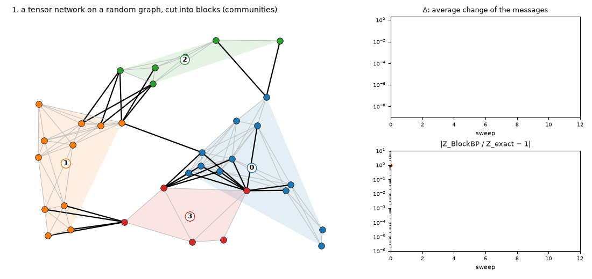
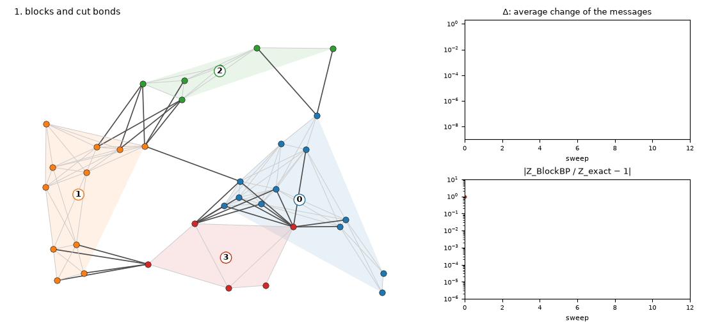
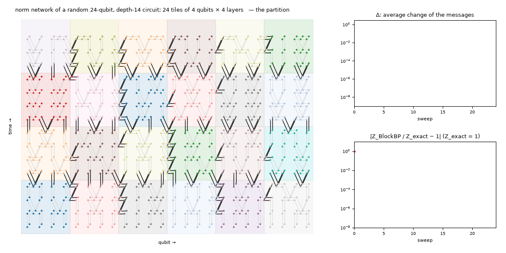
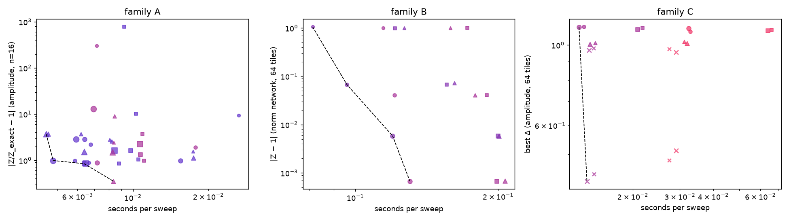
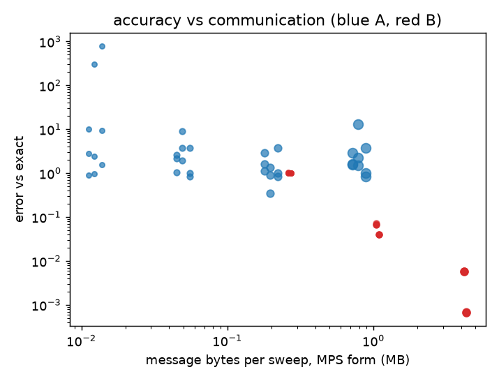

# BlockBP on a random circuit

Boundary-MPS contraction sweeps one MPS through a 2D network. BlockBP cuts the network into
blocks that exchange MPS messages until they agree. On a tree of blocks the result is exact; on
a grid of blocks it is the Bethe approximation, and whether that approximation can be reached
at all depends on the network. By §3 you will have seen the same random circuit fail to converge
on every loopy tiling of its amplitude network and converge to $10^{-15}$ on its norm network.

This assumes fluency in MPS/PEPS contraction and truncation. Every number comes from
`results/blockbp_T*.log` (tests, `tests_blockbp.py`), `results/blockbp_local_*.json` (4-rank MPI
runs), `results/blockbp_sizing*.json` (tile sizing) or `results_perlmutter/` (job 57633487).
Sources: `refs/2301.05844v3` (Guo, Poletti, Arad), `refs/2402.04834` (Kaufmann, Arad),
`refs/2411.04957` (Hack).

---

## 1. The algorithm

Partition the closed network into blocks. Each ordered pair of adjacent blocks keeps one MPS
message on the bonds cut by that block edge:

```
        m_{A→B}
   ┌───────┐ ─────▶ ┌───────┐
   │   A   │        │   B   │        message = MPS over the cut bonds, bond ≤ χ_m
   │ T T T │ ◀───── │ T T T │
   └───────┘ m_{B→A}└───────┘
        ▲ m_{C→A}  (from the block below)
```

$$
m^{(\ell+1)}_{A\to B} \;=\; \mathrm{Tr}\!\left( T_A \prod_{A' \in N_A \setminus \{B\}} m^{(\ell)}_{A'\to A} \right)
$$

> **Sweep alg.** Contract block $A$ with every incoming message except the one from $B$. The
> result is a tensor over the $A$–$B$ cut bonds. Write it as an MPS with bond $\le \chi_m$,
> left-canonical, unit $L^2$ norm (2402.04834, remark 3). Distance between sweeps, gauge and
> phase invariant:
>
> $$
> \Delta \;=\; \left( \frac{1}{M} \sum_{e} \big\| \, |m_e\rangle\langle m_e| - |m_e'\rangle\langle m_e'| \, \big\|_F^2 \right)^{1/2}
> $$
>
> Stop at $\Delta < \delta_0$ ($10^{-5}$ in the papers); trust the result only if $\Delta < \delta_1$.
> Optional damping, recompressed to $\chi_m$:
>
> $$
> m \;\leftarrow\; (1-\eta)\, m_{\mathrm{new}} + \eta\, m_{\mathrm{old}}
> $$
>
> Inference, the Bethe free energy as products of small contractions (2402.04834, Lemma 1):
>
> $$
> \log Z \;\approx\; \sum_A \log \mathrm{Tr}\!\Big( T_A \prod_{A' \in N_A} m_{A'\to A} \Big)
> \;-\; \sum_{(A,B)} \log \mathrm{Tr}\big( m_{A\to B}\, m_{B\to A} \big)
> $$
>
> The pairing $\mathrm{Tr}(m_{A\to B}\, m_{B\to A})$ is bilinear, not an inner product.

| object | in `tnpart/blockbp.py` |
|---|---|
| block edge | the set of network indices shared by two blocks (`edges`) |
| bond order on the cut | Fiedler coordinate of the attachment tensors, or a user key (`order`) |
| message | `MatrixProductState` reindexed onto the cut bonds, canonical, unit norm |
| block contraction | exact (greedy path), then SVD to $\chi_m$; cost $2^{\text{cut}}$ |
| $\Delta$, damping, schedules | `iterate()`; `schedule='parallel'` (flooded) or `'sequential'` |

The dense-then-compress route is the generic-graph choice. On a lattice tile the papers' zip-up
boundary MPS does the same job in $O(\chi_m^3)$ per site and is the production replacement.

## 2. Tree of blocks: exact. Grid of blocks: Bethe.

Hack (2411.04957) classifies BlockBP as the tree-equivalent method: a message carries the whole
information of a neighbourhood across one cut, so the fixed point is exact when the block graph
has no cycles and is the Bethe fixed point otherwise. The tests show both:

| test (`results/blockbp_T*.log`) | block graph | outcome |
|---|---|---|
| T1 2×8 random TN, 2×2 blocks | path | error $3\cdot10^{-15}$ once $\chi_m \ge$ cut rank; 270 % at $\chi_m = 1$ |
| T3 circuit amplitude, 8-qubit time slabs | path | 0.97 / 0.045 / $5\cdot10^{-15}$ at $\chi_m$ = 2 / 4 / 8 |
| T2 6×6 random TN, positive entries | 2×2 or 3×3 grid | converges in 5 to 8 sweeps, error $3\cdot10^{-4}$ |
| T2 6×6 random TN, signed entries | 3×3 / 2×2 grid | converges, 25 % / 42 % off |
| T3 circuit amplitude, spacetime tiles | grid | $\Delta \approx$ 0.5 to 0.8 after 60 sweeps, no fixed point |
| T4 circuit norm network, same tiles | grid | $10^{-15}$ in 4 to 10 sweeps for $\chi_m \ge 4$ |

On a tree the only error is message truncation, and it drops sharply at the rank of the cut (T3:
97 % to 4.5 % to exact). On a grid two things happen at once: the fixed point is wrong by the
Bethe loop error, which block size controls (T2: 42 % to 25 % from 2×2 to 3×3 blocks, $\chi_m$
irrelevant), and the fixed point may not attract at all (check notes for further disc).

## 2b. Watch it run



The movie is the real code (`make_blockbp_gif.py`, about 1 min): 34 positive tensors on a random
geometric graph, 110 bonds, four blocks from modularity communities, 27 cut bonds. What to watch
(13 frames, one per sweep). Frame 1: the partition. Coloured hulls are blocks, black bonds are
cuts, grey bonds stay inside a block and are never approximated. Frame 2: one arrow per direction
on every block edge; its width is how much that message changed in the last sweep. Frames 3 to 6:
each block contracts itself with its incoming messages and sends the result on; the arrows thin as
the messages settle. Right panels: $\Delta$ falls $1.3 \to 0.16 \to 6.8\times10^{-3} \to 1.1\times10^{-5}$ over
sweeps 1 to 4, then sits on its $10^{-8}$ floor; the Bethe estimate lands within $8.3\times10^{-7}$ of the
exact contraction by sweep 3. That residual is the loop error of §2, not a convergence problem.



A bond is an index shared by two tensors; when the two tensors
sit in different blocks the bond is cut. The message from the orange block (1) to the red block
(3) is the orange block's summary of itself as seen from the cut bonds: contract every orange
tensor together with the messages orange already received from blue and green, and leave open
exactly the legs that cross into red. That tensor has one leg per orange–red cut bond, $2^8$
entries for eight cut bonds and exponentially many in general, so it is stored as a chain, one
small tensor per cut bond, joined by virtual bonds of dimension $\le \chi_m$:

```
   orange block                    red block
   ●───┐                                        cut bond k  ←  one square of the message
   ●───┼──▶ ■━■━■━■  =  m_{1→3}                 ■ : the message's tensor for that cut bond
   ●───┘    (chain over the 4 cut bonds)        ━ : an MPS bond (dimension ≤ χ_m)
```

An orange square is one site of a message sent by orange, drawn at its cut bond and nudged into
the receiving block; the bars are the MPS bonds in the fixed order the code gives that block edge.
The red tensor at the bottom left is a hub: four orange tensors have bonds into it, so four
orange–red cut bonds end there and the four squares of $m_{1\to 3}$ sit around it. Pair 1–2 shares
one cut bond, so its messages are single tensors. Message length is the boundary size, which is
the communication cost. Squares shrink and fade as that message stops changing.




The same two renders on a circuit network (`make_blockbp_circuit_gif.py --sweeps 24 --chi-m 8`,
about 3 min): the norm network of a random non-brickwork 24-qubit, depth-14 circuit, 974 tensors,
1204 bonds, laid out as spacetime (qubit to the right, time upward, ket and bra as paired dots),
tiled into 24 blocks of 4 qubits × 4 layers, 260 cut bonds, boundaries of up to 14 bonds. What to
watch (25 frames). Time-cuts, the horizontal block edges, cross every qubit wire in both layers,
so their messages are 8-site chains. Qubit-cuts, the vertical edges, are crossed only by gates
that straddle the boundary, so their messages are short. Arrows stay thick for the first six
sweeps while information crosses the 6×4 block grid, then thin from the outer tiles inward.
$\Delta$ goes $1.4 \to 0.10$ by sweep 12 and $3.4\times10^{-5}$ by sweep 24; the estimate of
$\langle\psi|\psi\rangle$ settles $3\times10^{-5}$ from 1. With `--network amplitude` the arrows never thin (§3).

## 3. Why the amplitude network does not converge

A random-circuit amplitude $\langle 0|U|0\rangle$ is a sum over exponentially many paths with
random phases. Cut the network into tiles and each message is a partial sum whose phases are not
aligned with those of the message coming the other way. The product structure BP assumes
(environment = product of messages) has no small parameter: no loop decay in the sense of Midha
and Zhang, so nothing pulls the iteration to a fixed point. The norm network $\langle\psi|\psi\rangle$
is the opposite case: unitarity makes every time-slab environment proportional to the identity,
the messages are PSD-like, and the fixed point exists and attracts (T4, check my notes).

> **Two tiles.** Take tiles $A$, $B$ with a cut of $L$ bonds and write the exact amplitude as a
> sum over the $2^L$ boundary configurations $x$,
>
> $$
> Z \;=\; \sum_{x \in \{0,1\}^L} a(x)\, b(x), \qquad
> Z_{\mathrm{BlockBP}} \;=\; \mathrm{Tr}\big( m_A\, m_B \big), \quad m_A \approx a \text{ compressed to bond } \chi_m .
> $$
>
> For the norm network $a(x) = \overline{b(x)}$ up to a unitary, so the sum is a norm: positive,
> dominated by a few large terms, compressible. For the amplitude $a$ and $b$ are independent
> random-phase vectors: the sum is a random walk in the complex plane that depends on all $2^L$
> terms, with no hierarchy for $\chi_m$ to exploit.

The strategy description from my notes(§6) confirms this on the 6-block toy: flooded and 2-colour schedules converge
to $\Delta \approx 10^{-6}$ but 7.4 % off the exact amplitude; $\eta = 0.6$ damping, quenched damping
and relay legs do not converge and land 5 to 90 % off (`results/blockbp_local_amp.json`). On the norm
control the undamped schedules reach $10^{-15}$ in 6 to 8 sweeps and heavy damping only slows them
(`results/blockbp_local_norm.json`).

## 4. Stability analysis: what to measure

1. A positivity proxy per block, e.g. the spread of $\arg Z_A$ across sweeps, against
   convergence. This is the 0.2 negativity threshold of generalized BP in another guise.
2. The block-graph cycle rank, with error tracked along tilings that stay a tree as long as
   possible (time slabs spanning all qubits = boundary MPS = exact).
3. Schedule agreement: flooded and colour-ordered updates must reach the same $\log Z$. A run
   where they disagree is rejected regardless of $\Delta$ (T3 sequential updates "converge" to
   values off by $O(1)$).
4. $\Delta$ has a floor of $\sqrt{\varepsilon} \approx 10^{-8}$ from its definition, so $\delta_0 \ge 10^{-7}$.
   Damping $\le 0.3$ and only to break limit cycles. Log-norms per message on deep circuits.
5. Message rank: the entanglement spectrum of exact messages on small instances sets $\chi_m$
   and tests the bond ordering (Fiedler versus coordinate order, the cutwidth question).
6. When loops do not decay: larger blocks until the block graph is a tree, then shifted
   partitions, then overlapping regions (T-MITE/GBP, with its own negativity limit), then loop
   or cluster corrections on top of the fixed point.

## 5. Tile size per rank

One tile per rank, four ranks per node. The t-cut (between time-blocks, length = bq wires of
dimension 2) crosses nodes; the q-cut (a few straddling gates, 1 to 4 bonds) stays on the node:

```
   node 0 ────────────────────────────  node 1 ──────────────
   ┌────┐ ┌────┐ ┌────┐ ┌────┐          ┌────┐ ┌────┐        q →
   │ r0 │ │ r1 │ │ r2 │ │ r3 │  t-block │ r4 │ │ r5 │ …
   └──┬─┘ └──┬─┘ └──┬─┘ └──┬─┘          └──┬─┘ └──┬─┘
   ───┼──────┼──────┼──────┼── Slingshot ──┼──────┼───  t-cut: bq bonds each
   ┌──┴─┐ ┌──┴─┐ ┌──┴─┐ ┌──┴─┐          ┌──┴─┐ ┌──┴─┐        t ↓
```

`blockbp_sizing.py` builds a tile with neighbours on all sides, attaches random messages and asks
cotengra for the cost of one outgoing message. Times use the calibrated A100 model (19 TF/s GEMM,
8.6 µs / 23 GB/s inter-node, 17 µs / 9 GB/s intra-node, host buffers):

| bq | bt | cut (t / q) | GF per iter | compute | memory | message MPS / dense | time in messages |
|---|---|---|---|---|---|---|---|
| 8 | 8 | 7 / 1 | < 0.01 | < 0.01 ms | 0.1 MB | 49 KB / 5 KB | 98 % |
| 12 | 8 | 12 / 4 | 0.03 | 0.02 ms | 1 MB | 70 KB / 132 KB | 78 % |
| 16 | 8 | 16 / 2 | 0.21 | 0.1 ms | 4 MB | 78 KB / 1.6 MB | 35 % |
| 20 | 8 | 20 / 1 | 0.70 | 0.4 ms | 17 MB | 115 KB / 25 MB | 21 % |

At bond dimension 2 a tile is cheap until its t-cut reaches about 16 bonds. Below that every
iteration is message latency (four messages, 0.06 to 0.1 ms, against microseconds of compute).
Above it compute grows as $2^{bq}$ and the dense boundary as $16 \cdot 2^{bq}$ bytes, about 270 MB
at bq = 24, so the dense route stops near bq = 26 on a 40 GB A100. Largest tile per rank for the
dense route: bq of 16 to 20 qubits × bt of 8 to 16 layers, 64 to 80 qubits per node. With true MPS
messages (cost linear in bq) the limit moves from cost to accuracy: a wider tile is a better
Bethe approximation until the tiles are time slabs and the method is boundary MPS.

## 6. The convergence experiment

`run_blockbp_mpi.py` gives each rank its tiles, sends messages as dense boundary vectors (exact
for cuts of at most 20 bonds; the truncation to $\chi_m$ is applied before sending) and runs a
strategy library from fresh initialisations under a time budget:

| knob | values in the presets |
|---|---|
| schedule | flooded; 2-colour Gauss–Seidel on the (q,t) grid |
| damping $\eta$ | 0, 0.15, 0.3, 0.6, 0.8 |
| quenched damping | $\eta_e \sim U(lo, hi)$ per directed edge, fixed (relay-BP memory strengths) |
| relay | re-draw the quenched $\eta$ after `leg` sweeps without convergence, 3 to 5 legs |
| init | random complex; uniform |
| $\chi_m$ | given, halved, doubled |

Per strategy it records $\Delta$ and the Bethe $\log Z$ after every sweep, the best sweep, and the
error against the exact amplitude when $n \le 24$. `perlmutter/blockbp_converge.sbatch` runs a small
exact-checkable instance, the amplitude network at scale and the norm-network control;
`perlmutter/blockbp_pareto.sbatch` runs the three sweeps of §6c; `perlmutter/plot_blockbp.py` and
`plot_blockbp_pareto.py` draw the pulled JSON.

## 6b. Sampling, TVD, mid-circuit measurement

A probability of an outcome is a Born-rule expectation $\langle\psi|P|\psi\rangle = \|P\psi\|^2$: a
double-layer network with a projector inserted, the norm network of §3 with some physical legs
fixed, not the amplitude network:

```
   ket  ──U──U──U──┬─ x₁ ─┬─ x₂ ─┬─ ? ──┐        fixed legs: sampled bits x₁, x₂
   bra  ──U†─U†─U†─┴──────┴──────┴─────┘        traced legs: not yet sampled
                 p(x₁,x₂) = this contraction / Z
```

$$
p(x_1,\dots,x_k) \;=\; \frac{\langle \psi | \, |x_1\dots x_k\rangle\langle x_1\dots x_k| \otimes \mathbb{1} \, |\psi\rangle}{\langle\psi|\psi\rangle},
\qquad
x_{k+1} \sim p(x_{k+1} \mid x_1,\dots,x_k)
$$

Perfect sampling draws one bit at a time from these conditionals (Ferris and Vidal; boundary-MPS
version in 2507.11424). A mid-circuit measurement is the same object with the projector at an
intermediate time, followed by renormalisation and, with feed-forward, a branch chosen by the
outcome. All of these live on the network BlockBP handles well (T4), with messages that stay
PSD-like because projectors are positive.

The amplitude network $\langle x|U|0\rangle$ is needed only to evaluate one ideal probability
$|\langle x|U|0\rangle|^2$ for a given bitstring: cross-entropy benchmarking, or a TVD by enumerating
$p(x)$ at small $n$. Sampling from the simulated distribution and TVDs between sampled
distributions do not need it. For TVD-style comparisons and mid-circuit measurement the path is
BlockBP on the double-layer network with fixed legs, conditional marginals from block
environments, samples, and a TVD from samples. Accept/reject on amplitudes inherits §3 and is the
wrong tool.

## 6c. Numbers from Perlmutter

Job 57633487: 8 nodes, 64 ranks, 25 minutes on the debug queue.





Marker size grows with $\chi_m$, colour with tile width, shape with schedule (circle flooded, square
coloured, triangle damped, cross quenched or relay); the dashed line is the non-dominated front in
(seconds per sweep, error).

| sweep | network | size | result |
|---|---|---|---|
| A | amplitude, exact reference | n = 16, 12 tilings × $\chi_m \in \{2,4,8,16\}$ × 3 schedules | no run converged ($\Delta$ 0.5 to 1.1); errors 0.35 to 3.7, independent of $\chi_m$, tile shape and schedule |
| B | norm network, Z = 1 | n = 96 to 128, 64 tiles | error 1.06 / $6.7\cdot10^{-2}$ / $5.8\cdot10^{-3}$ at $\chi_m$ = 2 / 4 / 8 (6-wide tiles); $6.7\cdot10^{-4}$ at $\chi_m = 8$ with 8-wide tiles; 0.08 to 0.13 s per sweep |
| C | amplitude, no reference | n = 128 to 192, 64 tiles, 5 schedules | nothing converges ($\Delta$ 1.0 to 1.2; relay-quenched 0.42 to 0.52); the five schedules' $\log|Z|$ for one circuit spread from −32 to −50 (n = 128) and −48 to −66 (n = 192): no agreement, no trustworthy amplitude |

B is the accuracy-cost front: two decades of accuracy for 1.6× the time per sweep and 16× the
message bytes. A is the absence of a front. In A the $\chi_m$ = 8 and $\chi_m$ = 16 runs on 4-wide
tiles print identical numbers: a 4-bond cut has rank at most 16, so the message-rank axis is
saturated and what remains is the block-graph loop error, which no schedule removes. Honesty
clause: one seed per point, no repeats; B's converged run is a single case (29 sweeps,
$\Delta < 10^{-5}$), the rest stopped at the 30-sweep cap with $\Delta$ still falling.

## 7. What this does not show

- Only the dense-boundary route is implemented; the zip-up boundary-MPS block contraction of the
  papers (cuts beyond about 20 bonds, PEPS tiles at D > 2) is not.
- The MPI runner sends messages as dense vectors, so its byte counts overstate a production run
  by $2^L / (2L\chi_m^2)$; its timings are not the paper's communication numbers.
- No loop or cluster corrections, no overlapping regions, no shifted-partition averaging.
- Hyper-indices (a bond shared by more than two blocks) are rejected.
- Perlmutter runs are single-seed, no repeats.

## 8. Run it yourself

Local environment: Python 3.12 with `quimb`, `cotengra`, `kahypar`, `networkx`, `scipy`,
`matplotlib`, `mpi4py` (an MPI implementation is needed first, e.g. `brew install mpich` or
`apt install mpich`, then `pip install mpi4py`). The commands below assume a venv at `../.venv`;
substitute your interpreter.

```sh
# small-network tests T1 to T4; prints the tables of §2 (about 3 min)
../.venv/bin/python -u tests_blockbp.py tree loopy circuit norm

# distributed runner, 4 ranks on this machine; writes results/blockbp_local_{amp,norm}.json
mpirun -n 4 ../.venv/bin/python -u run_blockbp_mpi.py --n 8 --depth 8 --bq 4 --bt 4     --preset basic --exact --budget 15 --tag local_amp
mpirun -n 4 ../.venv/bin/python -u run_blockbp_mpi.py --n 8 --depth 8 --bq 4 --bt 4     --preset basic --network norm --exact --tag local_norm

# per-strategy Δ and error plots from those JSONs
../.venv/bin/python perlmutter/plot_blockbp.py results/blockbp_local_amp.json results/blockbp_local_norm.json

# tile sizing table of §5 (drop --machine to use built-in estimates)
../.venv/bin/python blockbp_sizing.py --bq 8 12 16 --bt 8 --chi-m 8

# the movies of §2b; writes results/blockbp_generic{,_mps}.gif and results/blockbp_circuit_norm{,_mps}.gif
../.venv/bin/python make_blockbp_gif.py
../.venv/bin/python make_blockbp_circuit_gif.py --sweeps 24 --chi-m 8
```

On an HPC system with Slurm (scripts are written for NERSC Perlmutter; adapt account, queue and
module names; the full walkthrough from ssh keys to plots is `perlmutter/RUNBOOK.md`):

```sh
# 1. copy the code up (uses your ~/.ssh/config; edit the host in perlmutter/push.sh)
bash perlmutter/push.sh
# 2. once, on a login node: conda env with a Cray-MPICH-linked mpi4py
ssh <host> 'bash -l ~/tn_partitioning/perlmutter/setup_perlmutter.sh'
# 3. submit (replace <project> with your allocation)
ssh <host> 'cd ~/tn_partitioning && sbatch -A <project> perlmutter/blockbp_pareto.sbatch'      # 8 nodes, debug, 25 min: sweeps A, B, C of §6c
ssh <host> 'cd ~/tn_partitioning && sbatch -A <project> perlmutter/blockbp_converge.sbatch'    # 8 nodes, debug, 5 min
ssh <host> 'cd ~/tn_partitioning && FULL=1 sbatch -A <project> -q regular -N 10 -t 01:00:00 perlmutter/blockbp_converge.sbatch'
# 4. fetch results and logs to results_perlmutter/ and logs_perlmutter/
bash perlmutter/pull.sh
# 5. figures and front tables of §6c
../.venv/bin/python perlmutter/plot_blockbp_pareto.py
```

## Glossary

| word | as used here |
|---|---|
| block edge | the set of network indices cut between two blocks; one message each way (§1) |
| message | an MPS over a block edge's bonds in a fixed order, canonical and unit-norm (§1) |
| $\Delta$ | projector distance between consecutive messages, averaged; floor $\sqrt{\varepsilon}$ (§1, §4) |
| Bethe estimate | $\sum_A \log Z_A - \sum_{(A,B)} \log \mathrm{Tr}(m_{A\to B} m_{B\to A})$; exact on a tree of blocks (§1, §2) |
| tree-equivalent | Hack's term for schemes where only cut variables are shared between regions; BlockBP (§2) |
| loop decay | the Midha and Zhang condition for cluster corrections to converge; absent for random-phase amplitudes (§3) |
| quenched damping | a fixed random $\eta$ per edge, relay-BP style; re-drawn per relay leg (§6) |
